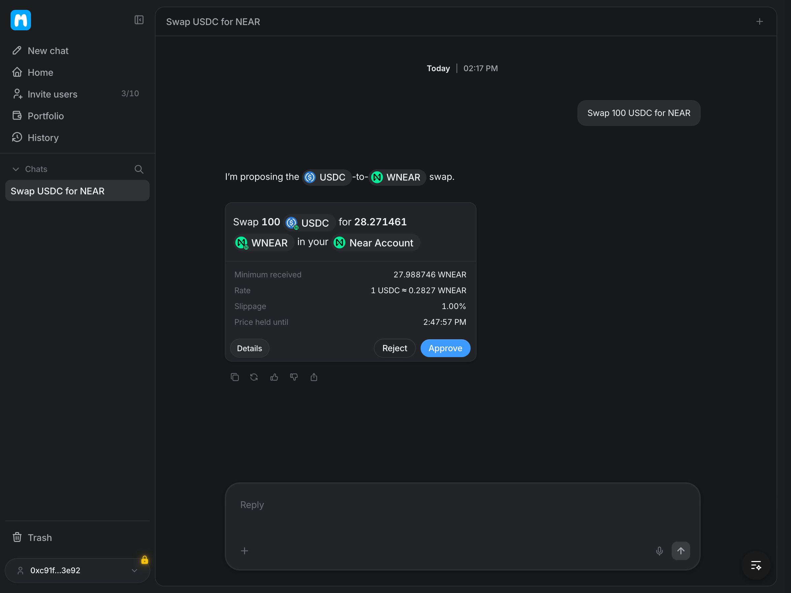
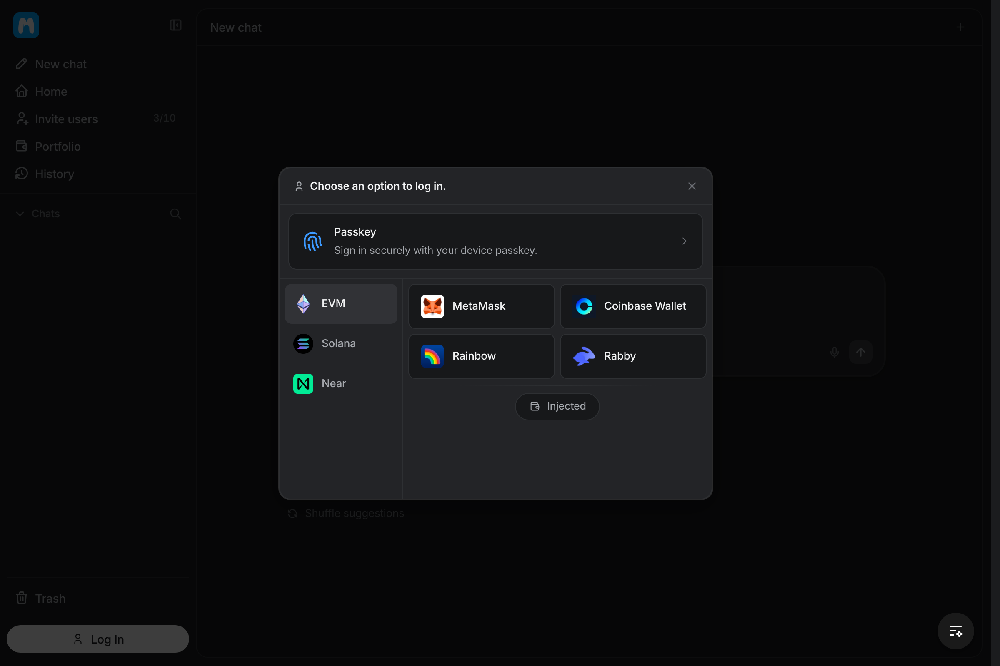
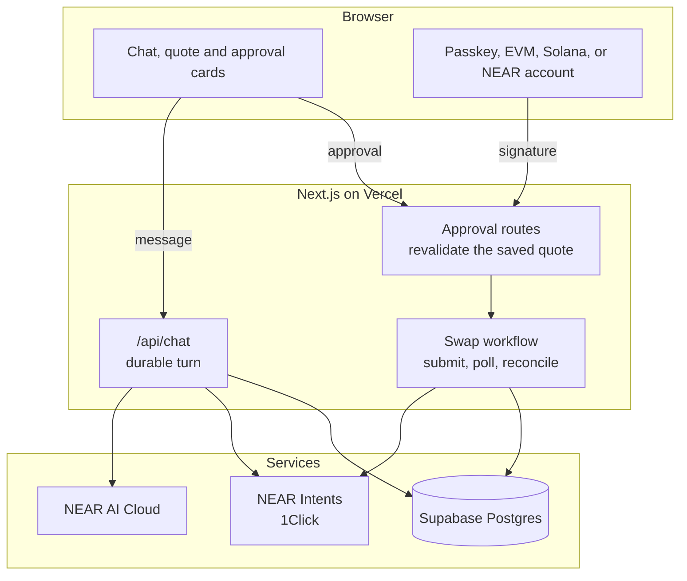
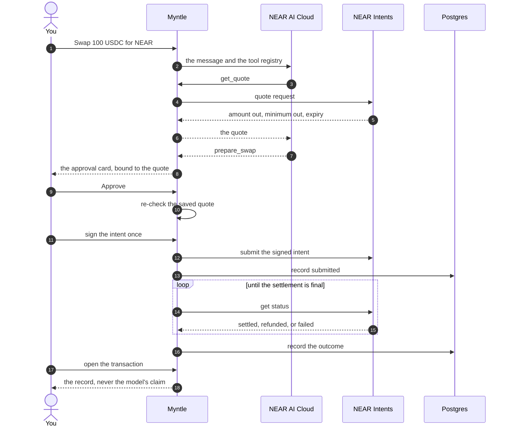

<p align="center">
  <a href="https://myntle.xyz">
    
  </a>
</p>

<h1 align="center">Myntle</h1>

<p align="center">
  Myntle lets you ask for a trade in plain language, approve the exact numbers once, and see what actually settled.
</p>

<p align="center">
  <a href="https://myntle.xyz"></a>
  <a href="https://x.com/myntlefinance"></a>
  <a href="https://github.com/myntlefinance"></a>
</p>

<p align="center">
  <a href="docs/images/trade.png">
    
  </a>
</p>

Myntle is for someone who already holds tokens, whether they keep them in a wallet or want to start with a passkey. You can create an account with a passkey on the device you are using, or connect a wallet you already have. Either way, the same conversation works: you need no account on the chain that settles the trade, no gas on a new network, and no faucet.

> The assistant can propose a trade and look things up, but it cannot sign or move money. A trade is finished only when the settlement record says so.

The assistant runs on NEAR AI Cloud, the trade settles through NEAR Intents, and the conversations and transaction records live in Supabase Postgres. The application holds no private keys and no funds. The live app is at [app.myntle.xyz](https://app.myntle.xyz).

## What you can do

### A trade is a sentence

You type something like swapping a hundred USDC for NEAR, and the assistant turns it into a quote instead of a guess. You see what you would receive, the minimum you would accept, the rate, the slippage bound, and the moment the quote expires. Nothing is signed before you approve that card, and rejecting it is a normal answer that leaves the conversation running.

### Start with a passkey or a wallet

A passkey account is created with your device's authenticator, so there is nothing to install and no extension to connect. If you already have a wallet, it connects through wagmi and viem on EVM, the Wallet Standard on Solana, and near-connect on NEAR, all behind the same interface. The conversation does not change with the account, because every account can sign the intent that settles the trade.

<p align="center">
  <a href="docs/images/wallets.png">
    
  </a>
</p>

The portfolio is the same account seen from another angle. It shows what the account holds on chain and in the private balance, and it can track any address read-only without asking for a signature.

### You approve the numbers, and the record decides

The approval is bound to the quote the server saved, not to anything the browser sends back. If the values are changed in devtools, the server refuses with "The trade changed since it was priced." If the quote has expired, it refuses that too, and the card has already expired on screen. After you sign, the trade moves through quoted, authorized, submitted, pending, and settled only as the settlement source confirms each step. When funds arrive but the trade is never filled, the screen says the money is coming back instead of painting a success for half of the story.

### A price you set, and yield you can see

A market swap is not the only way to use the account. Ask for a price you set and the assistant prices a limit order: the order rests until it fills, you cancel it, or its deadline passes. A partial fill is reported as it happens, and cancelling refunds the unfilled amount through the same order record.

Ask what you can earn and the assistant lists the yield vaults available through NEAR Intents, with the protocol, the chain, the receipt token, and the current APY when the aggregator reports one. A deposit into a vault is the same one-signature approval as a swap; redeeming it is a quote back to the payment asset. Both work for a connected wallet and for a passkey account, because both sign the same intent.

### The assistant reads the market too

A trade is not the only thing you can ask about. The same turn can search Google News, Reddit, and X, read the full text of a page it found, and resolve an ENS or SNS name. Those reads are fetched once per turn and served back in blocks rather than cut down to a display limit, so a long X thread stays whole and the model does not pay for the same search twice.

### Privacy is the default

Every trade quote is confidential, and there is no public mode to select. A trade between two external chains asks the verifier for basic or advanced confidentiality, and a trade that spends the balance inside NEAR Intents signs against `CONFIDENTIAL_INTENTS`. The interface calls that balance the Super account: it is unlocked in the browser, the access token never reaches the server, and the private read goes straight to 1Click.

## How it works

Myntle is four layers that can be replaced independently: a Next.js client that renders the conversation and the cards, a server route that owns the model and the tools, deterministic code that authorizes and executes a trade, and a durable workflow that reconciles the result.



The chat turn is a workflow run rather than a response-owned stream, so a reload or a dropped connection resumes the same answer instead of cancelling it. The toolset holds twenty-two tools, scoped to the intent of each turn. Four of them can propose a movement of funds, and each one pauses for approval; the rest only read or ask you to unlock the Super account. No tool signs, and every trade passes through server validation before it can become a transaction.

The approval routes validate the request against the connected account, and once the intent is signed and submitted, `swap-lifecycle` polls the settlement and records the outcome. The workflow holds no state of its own: everything is written to Postgres as it goes, a failed status poll is retried, and a settlement that failed on chain is final. The portfolio's price feed is a separate Cloudflare Worker that combines several sources behind one cache and a live stream; a trade quote always uses 1Click's own amount.

## How a swap settles



The server rebuilds the intent from the parameters it saved before the card was shown, the account signs a message rather than a transaction, and the signed intent settles inside the verifier contract. The user needs no NEAR account and no gas, and the signature never passes through the model.

## Quickstart

Bun 1.4.3 manages packages and runs the development server. Node 22 or newer runs the production build and the test suite.

```bash
bun install
cp .env.example .env.local
bun run dev
```

Fill in `.env.local` before you expect trades to work. The trade path needs the NEAR AI Cloud key, the 1Click partner key, the WalletConnect project id, the Supabase URL and service role key, and the approval secret. The news tools need their own keys and are optional. Contract addresses and RPC URLs are configuration rather than secrets, and the filled-in file is never committed.

The passkey account is disabled by default in a fresh checkout. Set `PASSKEY_ENABLED=true` and `NEXT_PUBLIC_PASSKEY_ENABLED=true` to turn it on; the WebAuthn relying party defaults to localhost in development.

| Command | What it does |
|---|---|
| `bun run dev` | Development server on Bun |
| `bun run build` | Production build |
| `bun run typecheck` | TypeScript checks |
| `bun run lint` | ESLint |
| `bun run test` | Vitest, which runs on Node |
| `bun run workflow:web` | Inspector for durable runs |
| `bun run prices:deploy` | Deploy the price Worker |

## Project layout

```text
app/
  api/chat/route.ts              the assistant turn
  api/chat/[id]/stream/route.ts  replay from the client's cursor
  api/approve/route.ts           approval to the swap workflow
  api/intents/                   confidential quote, deposit, and submit
  api/orders/                    limit orders, their refresh, and cancel
  api/earn/                      the public yield catalogue and live APYs
  api/tx/[id]/route.ts           the transaction record
  (app)/page.tsx                 the chat screen
workflows/
  chat-turn.ts                   model, tools, persistence
  swap-lifecycle.ts              submit, poll, reconcile
  limit-order-lifecycle.ts       poll a resting order and write its fills
lib/
  ai/                            provider, prompts, tool registry
  auth/                          passkeys, sessions, challenges
  intents/                       quotes, approval checks, settlement, orders
  earn/                          the yield vaults and their APY source
  wallet/                        EVM, Solana, and NEAR adapters
  news/                          Google News, Reddit, and X
  db/                            schema and queries
components/
  app/                           chat, cards, portfolio, history
  finance/                       money screens and primitives
  site/                          the chat harness
cloudflare/prices/               the price Worker
supabase/                        migrations
```

## Verification

These checks need the install above and the keys in `.env.local`. The first four move no funds; the fifth reads outcomes from trades you have already made; and the last is the four commands that must pass.

1. Pricing is live: ask "what can I trade" and then "price 100 USDC to NEAR". The amounts come from the 1Click quote API, tickers resolve to full chain contract ids, and an unknown ticker gets a plain refusal instead of a guess.
2. Approval binds: open devtools, edit the approval payload before signing, and submit. The server compares it against its saved quote and rejects with "The trade changed since it was priced." Nothing is created.
3. Expiry holds: wait past a quote card and approve it. The card reads expired locally, and the server rejects the stale quote with "Your approval has expired."
4. Refusal continues: press Reject on a card. The card paints denied and the conversation carries on; nothing hangs.
5. Outcomes differ: a failed trade paints failed, a refunded one paints refunded with the money-back meaning, and anything still moving keeps polling its record. Close the laptop mid-trade and reopen the transaction; the state moved on alone.
6. Full loop: `bun run typecheck`, `bun run lint`, `bun run test`, and `bun run build` must all pass. The build compiles both workflows.

For development without a browser extension, setting `DEV_WALLET_KEY` installs a keyed provider that signs the challenge for real. It covers EVM only, and the dev wallet route returns 404 in a production build.

## Contributing

Start with `PRODUCT.md` for who the product is for and what it refuses to do, `DESIGN.md` for the interface foundation, and `AGENTS.md` for the rules a contributor or an agent has to follow. Several early assumptions were overturned during research, and the corrections live in those files.

Prototype interface work in the lab before building it into the product. Create a component in `components/lab/samples/` that takes an optional variant, register it in `components/lab/registry.ts`, iterate at `/lab`, and move the finished version into `components/finance/`. Nothing in the application imports from the lab, so a prototype cannot break anything that ships.

Keep tools narrow and keep the assistant away from money. Each tool does one job, only three can propose a movement of funds, and no new signing or network tool may be added. Model output never reaches a signature without passing through server validation, approvals stay cryptographically checked, and every agent call sets an explicit step bound.

Do not commit secrets, do not sign a mainnet transaction or spend funds without an explicit instruction from the person in charge, and write interface copy as sentences a person could say out loud. If a line of text can be deleted without losing meaning, delete it, and keep numbers on screen to the ones the reader needs in order to decide.

## Credits

The interface foundation comes from BeautifulUI. The primitives in `components/atoms/` and `components/primitives/`, the harness in `components/site/Harness.tsx` that this application drives with the live assistant, and the design tokens the finance screens build on are adapted from that system, and the finance screens themselves were built for this project. Settlement and quotes are NEAR Intents' 1Click, the model runs on NEAR AI Cloud, and durable execution uses the Workflow SDK.
